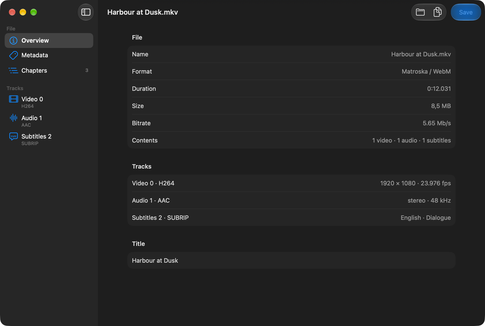

<p align="center">
  
</p>

<h1 align="center">MetaLens</h1>

<p align="center">
  A metadata viewer and editor for audio, video and image files on macOS.<br>
  A native SwiftUI app that reads and writes through <a href="https://ffmpeg.org">FFmpeg</a>, so MKV, subtitles and chapters are supported too.
</p>

<p align="center">
  
</p>

## Features

- **Open a file**: with **Open…** (⌘O), by dragging it onto the window, from the Finder's **Open With** menu
  (movies, audio and images), or from the terminal as an argument.
- **Overview**: name, format, MP4/MOV profile (major brand), duration, size, bitrate, a count of tracks by type,
  and the file title.
- **Track details**: codec, profile, codec ID, bitrate, language and title for every track; for video also
  resolution, coded size, aspect ratio, frame rate, pixel format, bit depth, scan type, color, color range,
  level and frame count; for audio channels and sample rate; for subtitles the number of events. A **Features** row
  marks Dolby Vision, HDR10, HLG, default and forced tracks and cover art.
- **Chapters**: a table with start, end and title, shown when the file has chapters.
- **Edit metadata**: file-wide tags under **Metadata** and per-track tags on each track. Add a field (with
  **Suggested Fields** such as `title`, `artist`, `album`, `language`), change it, or remove it and restore it
  before saving. Edited fields are marked, and the window subtitle counts the unsaved changes.
- **Save** (⌘S): after a confirmation, the file is rewritten with the new tags. Audio and video are copied,
  never re-encoded, and an empty field removes the tag.
- **Copy Report** (⇧⌘C): copies a plain-text summary of the file and its tracks to the clipboard.
- **Images**: their metadata is shown but not written, because rewriting the file with FFmpeg would lose
  the EXIF data and the color profile.
- **Languages**: English and Italian, following the system language; other languages get English.
- **macOS 26 design**: Liquid Glass toolbar and a Liquid Glass icon on macOS 26 and later; the classic look on
  macOS 14 and 15.

## Requirements

- macOS 14 or later
- Xcode 26 or later, to build the app: Swift 5.10 for the code and `actool` for the Icon Composer icon
- FFmpeg, which provides `ffprobe` to read files and `ffmpeg` to write them:

  ```bash
  brew install ffmpeg
  ```

  MetaLens looks for both tools in `/opt/homebrew/bin`, `/usr/local/bin` and `/usr/bin`, not in your `PATH`.

## Installation

```bash
git clone https://github.com/giuliomaffei90/MetaLens.git
cd MetaLens
Scripts/bundle.sh release
open .build/MetaLens.app
```

[`Scripts/bundle.sh`](Scripts/bundle.sh) builds the binary with SwiftPM and wraps it in
`.build/MetaLens.app` with [`Info.plist`](Resources/Info.plist) and the translations in `Resources`, then
compiles [`AppIcon.icon`](AppIcon.icon) with `actool` into `Assets.car` (Liquid Glass) and `AppIcon.icns`
(older systems), and signs the app ad hoc. It stamps the binary with the real SDK version
(`-platform_version`): SwiftPM would otherwise record the deployment target as the SDK, and macOS would draw
the app with the macOS 14 look on every system. The minimum version is set in three places that must change
together: `MIN_MACOS` in the script, [`Package.swift`](Package.swift) and `Resources/Info.plist`.

For development:

```bash
swift build      # build
swift test       # metadata read/write tests (needs FFmpeg)
Scripts/bundle.sh
.build/MetaLens.app/Contents/MacOS/MetaLens video.mkv   # open a file from the terminal
```

You can also open `Package.swift` in Xcode. The code is in two targets:
[`Sources/MetaLensKit`](Sources/MetaLensKit) (FFmpeg, data model and formatting, testable without an
interface) and [`Sources/MetaLens`](Sources/MetaLens) (the SwiftUI interface). The icon is an Icon Composer
document: `open -a "Icon Composer" AppIcon.icon`.

Strings in the code are written in Italian and serve as keys;
[`Resources/en.lproj/Localizable.strings`](Resources/en.lproj/Localizable.strings) holds the English text.
The empty `it.lproj` table is needed: without it an Italian system would fall back to English, the
development region.

## How it works

1. **Reading**: [`Media.probe`](Sources/MetaLensKit/MediaInfo.swift) runs
   `ffprobe -v error -print_format json -show_format -show_streams -show_chapters <file>` and decodes the JSON
   into `MediaInfo`.
2. **Display**: [`Fmt`](Sources/MetaLensKit/Fmt.swift) turns the raw values into what the window shows: the
   H.264 and HEVC level (stored ×10 and ×30), frame rates, bitrates, language names in the interface
   language. For a still image it hides the frame rate, duration and bitrate, which FFmpeg reports as muxer
   defaults rather than properties of the file.
3. **Editing**: [`AppModel`](Sources/MetaLens/AppModel.swift) keeps a draft of the file and track tags and
   compares it with the original, so only the fields you changed are written.
4. **Saving**: `Media.save` runs
   `ffmpeg -v error -y -i <file> -map 0 -c copy -ignore_unknown -metadata key=value -metadata:s:<track> key=value …`
   into `.metalens-tmp-<name>` in the same folder, then replaces the original with
   `FileManager.replaceItemAt` only once FFmpeg has written a complete file. The file is then read again.

## Known limitations

- FFmpeg is not bundled: it has to be installed with Homebrew or be in `/usr/bin`.
- MP4 and MOV keep only the tags the FFmpeg `mov` muxer knows; custom keys are dropped when saving.
- Image metadata is read-only.
- Saving writes a full copy of the file next to the original, so it needs as much free space as the file
  takes.
- One file at a time: opening or dropping a file replaces the current one, and only the first of several
  dropped files is opened.
- Sizes follow the region format of the system, so they can show a decimal comma in the English interface.
